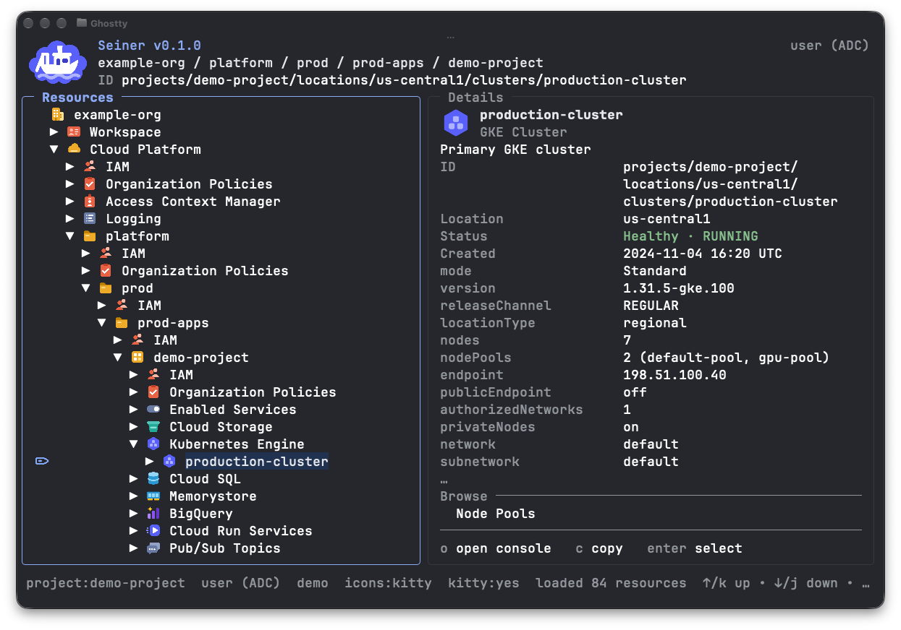

# Seiner

[](https://github.com/tensleyconsulting/seiner/actions/workflows/ci.yml)
[](https://pkg.go.dev/github.com/tensleyconsulting/seiner)
[](https://github.com/tensleyconsulting/seiner/releases)
[](LICENSE)

`seiner` is a keyboard-driven terminal UI for browsing Google Cloud
resources: organizations, folders, and projects in one navigation pane, with
compute, networking, storage, data, security, and IAM resources under each.
It is read-only, and it runs on Linux and macOS, locally or on a remote
host over SSH, where copy and full-color icons still work.



## Quick start

Try it without a Google Cloud account; `--demo` browses a built-in catalog:

```bash
go install github.com/tensleyconsulting/seiner/cmd/seiner@latest
seiner --demo
```

Against your own resources, sign in with Application Default Credentials
(ADC) and name a project, folder, or organization:

```bash
gcloud auth application-default login
seiner --project my-project
```

Without credentials, without a project, or when the live catalog fails to
open, Seiner starts with an empty navigation pane and a banner saying why. It
never falls back to demo data.

## Install

Seiner installs with Go 1.26 or later:

```bash
go install github.com/tensleyconsulting/seiner/cmd/seiner@latest
```

The binary goes to `$(go env GOPATH)/bin`, usually `~/go/bin`; make sure it
is on your `PATH`. Prebuilt binaries are not published yet.

### From a checkout

```bash
make build
./seiner
```

| `make` target | Does |
|---------------|------|
| `build` | Build `./seiner` |
| `test`, `vet` | `go test ./...`, `go vet ./...` |
| `race` | Adapter and app goroutine tests with `-race` |
| `boundary` | Fails if `internal/app` or `internal/ui` import a Google client library |
| `check` | `test` + `vet` + `boundary` |

## Terminals

Any reasonably capable terminal works in text mode. Product icons render in
full color with the Kitty graphics protocol; Kitty and Ghostty are detected
automatically. Copy uses the OSC 52 clipboard sequence, so it reaches your
local clipboard over SSH when your terminal allows it. See [Icons](#icons)
for SSH and tmux.

## What it shows

Organizations, folders, and projects are nodes in the navigation pane.
Under each, Seiner lists Cloud Storage, Cloud SQL, Memorystore, Secret Manager, Cloud KMS,
Certificate Authority Service, Compute Engine, GKE, Cloud Workstations,
Artifact Registry, VPC networking, load balancing, Cloud Armor, Certificate
Manager, Secure Web Proxy, Private Service Connect, Cloud DNS, BigQuery,
Cloud Logging, IAM, Identity-Aware Proxy, VPC Service Controls,
organization policies, Assured Workloads, and Google Workspace users and
groups.

Seiner never reads secret payloads, service account key material, or
table data, and it has no code path that changes a resource.

<details>
<summary>Every resource type</summary>

| Area | Resources |
|------|-----------|
| Storage and data | Cloud Storage buckets (with objects); Cloud SQL instances (with databases, users, and backups); Memorystore for Redis and Valkey; Secret Manager secrets (with versions, never payloads); Cloud KMS key rings (with keys and their versions, HSM attestations, import jobs, and permissions); Certificate Authority Service CA pools (with certificate authorities, Enterprise issued certificates and revocation lists, certificate templates, and permissions) |
| Compute and artifacts | VMs, disks, instance templates, managed instance groups (with their instances); GKE clusters, node pools, and nodes; Cloud Workstations clusters, configs, and workstations; Artifact Registry repositories (with packages, versions, and Container Analysis vulnerability findings) |
| Networking and edge security | VPC networks (subnets and firewalls are drills, not a flat list); routes; Cloud Routers and their Cloud NAT gateways; IP addresses; forwarding rules; load balancers (frontends, backends, health checks); Cloud Armor policies; SSL policies; Certificate Manager certificates, certificate maps (with entries), and DNS authorizations; Secure Web Proxy gateways (with security policies, rules, URL lists, and TLS inspection policies); Private Service Connect endpoints, published services (service attachments), regional endpoints, and service connection policies (with PSC connections); Cloud DNS zones (with record sets) |
| Analytics | BigQuery datasets (with tables, views, routines, ML models, and access lists; never table data); slot reservations (with their assignments) and capacity commitments; Data Transfer configs, including scheduled queries; external connections (never credentials) |
| Operations | Log sinks; log buckets (with views and linked datasets); log-based metrics; enabled APIs per project |
| Identity, access, and governance | IAM role bindings (including those inherited from folders and the organization), service accounts (with their keys, never key material), custom roles (with granted permissions); Identity-Aware Proxy (IAP) web, Compute, and App Engine targets; VPC Service Controls policies, service perimeters (ingress and egress rules), and Access Context Manager access levels; organization policies on each organization, folder, and project; Assured Workloads compliance badges on workload folders; Google Workspace users and groups (with group members) |

</details>

## Configuration

Flags override the config file, which overrides defaults. The project and
impersonation settings also read Google's standard environment variables,
which rank between flags and the file.

| Flag | Purpose |
|------|---------|
| `--initial-resource NAME` | Project, folder, or organization to start on: `projects/ID`, `folders/ID`, or `organizations/ID`. Defaults to the ADC quota project. |
| `--project ID` | Same as `--initial-resource projects/ID`. Env: `GOOGLE_CLOUD_PROJECT`, `GCP_PROJECT`, or `CLOUDSDK_CORE_PROJECT`. |
| `--demo` | Browse the built-in demo catalog instead of live data. |
| `--impersonate SA` | Service account to impersonate. Env: `GOOGLE_IMPERSONATE_SERVICE_ACCOUNT`. |
| `--icons MODE` | `auto` (default), `kitty`, `text`, or `none`. |
| `--icons-dir DIR` | Custom icons that replace the built-in ones (see [Custom icons](#custom-icons)). |
| `--list-icons` | Print the icon names `--icons-dir` can replace and exit. |
| `--aw-locations LOCS` | Comma-separated Assured Workloads locations (`us,europe-west3`); marks workload folders. |
| `--no-intro` | Skip the startup animation. |
| `--log-file PATH` | Log file, mode 0600. Defaults to `seiner.log` under `$XDG_STATE_HOME/seiner` (`~/.local/state/seiner` when unset). |
| `--debug` | Truncate the log for this run and print its path on stderr. |
| `--version` | Print the version and exit. |
| `--config PATH` | Config file to read. Defaults to `$XDG_CONFIG_HOME/seiner/config.yaml`. |

### Config file

Seiner reads `$XDG_CONFIG_HOME/seiner/config.yaml` (usually
`~/.config/seiner/config.yaml`) at startup, if it exists. Each key is the
long flag name, such as `icons: kitty`; every key is optional.

`initial-resource` is the resource name of the project, folder, or
organization to start on. The navigation pane starts with that node
selected and expanded, and you can browse the rest of the tree from there. A folder or
organization needs no project. `--project` and the project environment
variables are other ways to set it to a project, so the usual precedence
applies: `GOOGLE_CLOUD_PROJECT` in your environment overrides
`initial-resource` in the file, and `--initial-resource` overrides both.
Pass `--project` or `--initial-resource`, not both.

`--config` names another file; that file must exist. Unknown keys are an
error, so a typo does not go unnoticed. `--demo`, `--debug`,
`--list-icons`, and `--version` are per-run and have no key.

ADC is read from the usual places: `GOOGLE_APPLICATION_CREDENTIALS`, gcloud
ADC, or the metadata server. Logs never go to stdout.

Some APIs, such as IAM, are checked against your quota project (ADC's
`quota_project_id`, or `GOOGLE_CLOUD_QUOTA_PROJECT`), not the project you
browse. If one is off there, Seiner shows one warning naming the API and
the project. Enable it in that project, or bill another one with
`gcloud auth application-default set-quota-project PROJECT`. An API that
is off in the project you browse just shows nothing.

## Icons

When the terminal supports the Kitty graphics protocol, product badges
render in color. Otherwise they fall back to emoji (`🪣` for a bucket, `💼`
for a project); a terminal needs a color emoji font to show them. Over SSH,
`TERM` is often `xterm-256color`; if icons do not appear, force them with
`--icons kitty`.

Inside tmux or GNU screen, `auto` uses text icons: the multiplexer drops
Kitty graphics. (Herdr handles them in its pane emulator, so `auto` uses
Kitty icons there.) Under tmux 3.3 or later,
`--icons kitty` works with:

```
set -g allow-passthrough on
set -as terminal-features ',*:RGB'
```

The image IDs travel in 24-bit text colors, so tmux must pass RGB through.
Screen cannot pass the images.

### Custom icons

The built-in icons are original artwork made for Seiner. To use different
ones, put them in a directory and point `--icons-dir` (or `icons-dir:` in
the config file) at it. Each file replaces one icon:

```
~/.config/seiner/icons/
├── cloud-storage.svg
├── gke.png
└── logo.svg          # header and startup intro, 4:3 (wider than tall)
```

`seiner --list-icons` prints every name and what it shows. A file is
`NAME.svg` or `NAME.png`; when both exist the SVG wins. Any icon without a
file keeps its built-in artwork, so a partial set is fine. A file that
cannot be read or drawn is logged, and that icon stays built-in.

PNGs of any size are fitted into a square, except the logo, which keeps its
own shape and is drawn in a 4:3 box. SVGs are drawn with `oksvg`, which
handles ordinary icon artwork but not masks, clip paths, filters, or
embedded images. Symlinks work, so you can link names to files in a
downloaded icon pack without renaming it.

## Startup animation

The Seiner logo sails left to right, paying out a purse seine labeled GCP
Resources while a skiff holds the far end. As each service's results arrive,
its icon turns up in the sea and mills about as the boat sails around it.
Once every result is in, the boat stops and purses the net: the leadline
rises under the icons and the net closes into the bunt around them. Then the
intro dissolves into the navigation and details panes. Any key or click
skips it. It never plays with `--icons none` or in a terminal too small to
hold it.

## Keys

| Key | Action |
|-----|--------|
| `j` / `k` or arrows | Move |
| `h` / `l` or arrows | Previous / next pane |
| `g` / `G` | Top / bottom |
| `Enter` | Expand / collapse in the navigation pane (or select) |
| `Esc` | Collapse / back / clear search |
| `/` | Search |
| `r` | Refresh |
| `c` | Copy name / ID / JSON (and resource-specific extras) |
| `o` | Copy Cloud Console URL |
| `d` | Details |
| `m` | Show / hide messages pane |
| `v` | Role Bindings: switch between by role and by principal. Service Accounts: show or hide Google's accounts |
| `?` | Help |
| `q` or `Ctrl+C` | Quit |

Mouse:

- Click a row in the navigation pane to select it, or its triangle to expand
  or collapse.
- Click `○ role` / `○ principal` on the Role Bindings row to switch views.
- Click `○ yours` / `○ all` on the Service Accounts row to hide or show the
  service accounts Google created: the default Compute Engine and App Engine
  accounts, and service agents (`service-N@gcp-sa-….iam.gserviceaccount.com`,
  `N@cloudservices.gserviceaccount.com`). They are hidden by default. IAM
  cannot list service agents, so Seiner finds them in the project's IAM
  policy; an agent with no role there does not show. Each row keeps its
  own choice, like Role Bindings rows.
- Drag the border between the navigation and details panes to resize.

## The name

Seiner is pronounced "SAY-ner," like the river Seine, not "SEEN-er." A
seiner is a fishing boat that sets a purse seine: a wall of net it draws
around a whole school and closes underneath.

## More

- [docs/architecture.md](docs/architecture.md): structure and design
- [CONTRIBUTING.md](CONTRIBUTING.md): how to build, test, and send changes
- [SECURITY.md](SECURITY.md): reporting a vulnerability
- [AGENTS.md](AGENTS.md): conventions for coding agents

## License

Apache License 2.0. See [LICENSE](LICENSE).
